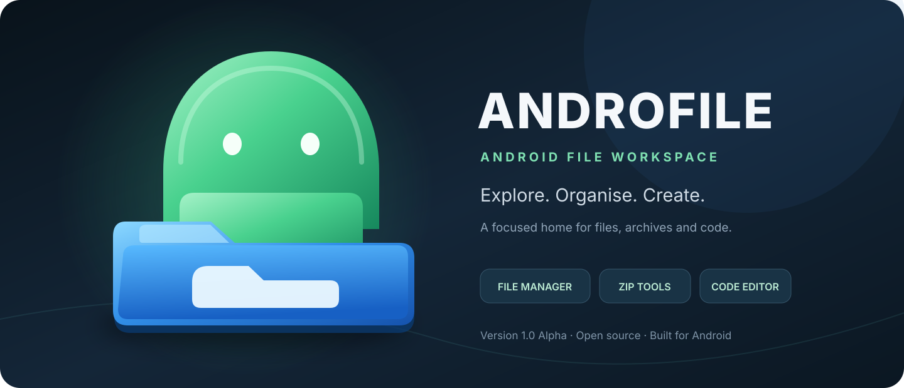

Project identity artwork · The UI shown in this banner is illustrative, not an in-app screenshot.

# ANDROFILE

**A modern Android file workspace.**

*Explore. Organise. Create.*

---

## About

AndroFile is an open-source Android file manager built around a simple idea: everyday file operations, archive handling, and lightweight code editing should live in one calm, well-designed workspace.

The **1.0 Alpha** establishes the native Android foundation. It focuses on honest storage permissions, real document operations, a custom visual identity, and a build produced by GitHub Actions.

## Alpha feature status

| Area | Status | Details |
|---|---|---|
| Folder browsing | Included | User-granted folders through Android Storage Access Framework |
| Create folder | Included | Creates a real directory in the selected document tree |
| Rename / delete | Included | Changes the actual selected document |
| Copy / move | Included | Stream-based copy; move removes the source only after a successful copy |
| ZIP create / extract | Included | ZIP streams, with unsafe archive paths rejected |
| Text and code editor | Included | Edit, save, cancel, and copy all |
| Syntax colours | Included | Lightweight highlighting for common code and markup |
| HTML preview | Included | In-app WebView preview with file access disabled |
| File-type icons | Included | Different icon and accent by file category |
| Theme customisation | Included | Background and accent presets |
| Shizuku verification | Included | Checks Binder availability and the app's actual permission state |
| 7z / RAR / TAR | Planned | Not advertised as working in this Alpha |
| Elevated Shizuku file operations | Planned | Verification is present; file engine currently uses user-granted SAF access |

> **Permission note:** Android restricts access to some system-managed locations. AndroFile only operates inside folders the user has granted to it in this Alpha. A Shizuku connection does not automatically mean root access, and a Shizuku grant is not yet used to bypass the Storage Access Framework.

## Features

- **Files:** Browse the folder you selected, open files with Android's app chooser, and manage documents.
- **Archives:** Create ZIP files and extract ZIP archives into a new folder.
- **Code:** Edit text, HTML, JSON, XML, CSS, JavaScript, Kotlin, Python, and other text formats with syntax colours.
- **HTML preview:** Render the current HTML document inside AndroFile. JavaScript runs in the preview page, but the WebView has no native app bridge and local-file access is disabled.
- **Settings:** Choose a background/accent preset and verify Shizuku's connection and permission state.

## Build the APK

The repository includes a GitHub Actions workflow. Every push to main builds a debug APK and publishes it as a workflow artifact.

1. Open the **Actions** tab.
2. Select **Android CI**.
3. Open the latest successful run.
4. Download **AndroFile-1.0-Alpha-debug** from Artifacts.

### Local build

Requirements: JDK 17, Android SDK platform 36, and Gradle 8.13.

    gradle wrapper --gradle-version 8.13
    ./gradlew assembleDebug

The APK is written to app/build/outputs/apk/debug/app-debug.apk.

## Tech stack

- Kotlin
- Jetpack Compose + Material 3
- Android Storage Access Framework
- AndroidX DocumentFile
- Shizuku API 13.1.5
- Java ZIP streams
- GitHub Actions

## Privacy and safety

- No analytics SDK or advertising SDK is included.
- No account or cloud storage is required.
- Folder access is granted by the user through Android's system picker.
- AndroFile does not request broad all-files access in this Alpha.
- HTML preview does not expose a JavaScript-to-native bridge and blocks access to local files and external network resources.

## Roadmap

- [x] Native Android project and custom launcher identity
- [x] SAF-backed real document browsing and operations
- [x] ZIP creation and extraction
- [x] Text/code editor with save, cancel, and copy-all
- [x] HTML preview
- [x] Theme presets and Shizuku status verification
- [ ] Archive format expansion (7z, TAR, GZIP, BZIP2)
- [ ] Multi-select and batch operations
- [ ] Shizuku UserService adapter for supported file operations
- [ ] Archive password handling and archive inspection
- [ ] Accessibility, localisation, and device testing

## Credits

**Created by CFSTUDIO-project.**  
Visual identity and application design: AndroFile contributors.

AndroFile uses open-source Android and Shizuku components. See their respective project pages and licences before redistributing modified builds.

## Contributing

Issues and pull requests are welcome. Include device model, Android version, steps to reproduce, and relevant redacted logs. See CONTRIBUTING.md.

---

**ANDROFILE · 1.0 Alpha**

Made for Android. Built in the open.

