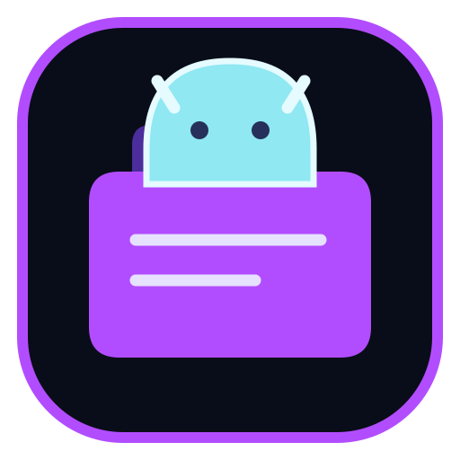

# ANDROFILE
**Your file space, reimagined.**

A local-first Android file manager with ZIP tools, a built-in code editor, HTML preview, and a lightweight browser.

---

## The idea

AndroFile brings everyday file operations and lightweight development tools into one focused Android workspace. The visual language combines a deep graphite canvas, restrained violet-to-cyan gradients, distinct file-type colours, and short transitions.

## 1.0 Alpha feature scope

| Module | Alpha implementation |
|---|---|
| File browser | Shared-storage browsing, current-folder search, sorting, hidden-file visibility |
| File operations | Create folder, rename, copy, cut, paste, multi-select, delete |
| File identity | Different icons and colours for folders, ZIP, code, HTML, images, audio, video, PDF, APK and text |
| ZIP tools | Inspect entries, create ZIP archives, extract to a new folder |
| Code editor | Line numbers, basic syntax colours, Copy All, Save and Cancel |
| HTML | Edit source and run a local WebView preview |
| Browser | In-app Android WebView with address/search input |
| Appearance | Five saved background/accent palettes |
| Shizuku | Detect app/service and verify AndroFile permission state |

## Important Alpha boundaries

- **Shizuku is verification-only in 1.0 Alpha.** Its service and permission state are checked through the Shizuku API, but file operations are not yet routed through a shell UserService. Access to `Android/data` and `Android/obb` is not promised.
- ZIP is the archive format implemented now. RAR, 7z, TAR, GZIP and other formats are roadmap items, not active features.
- Syntax colouring is lightweight token highlighting, not a full IDE or language server. AndroFile does not compile or execute arbitrary native code.
- The HTML preview and browser use Android WebView. This is not a Chromium fork or a hardened replacement browser.
- Android 11+ **All files access** is requested through the official Android Settings screen. The user must grant it manually; Android may still protect some system locations.

## Build

The Android CI workflow uses JDK 17, Android SDK 35 and Gradle 8.10.2.

1. Open the **Actions** tab.
2. Select **AndroFile Android CI**.
3. Run the workflow or push a commit to `main`.
4. Download the `AndroFile-debug-apk` artifact from the completed run.

The CI output is a debug APK for device testing, not a Play Store-signed release.

## Tech stack

- Kotlin · Jetpack Compose · Material 3
- Android shared-storage APIs and user-granted `MANAGE_EXTERNAL_STORAGE`
- Zip4j for ZIP operations
- RikkaApps Shizuku API for service/permission verification
- Android WebView for HTML preview and browsing
- GitHub Actions for Android CI

## Roadmap

- [ ] Shizuku UserService backend with operation-level checks
- [ ] SAF-backed folder browsing and safer fallback access
- [ ] RAR / 7z extraction and TAR/GZIP formats
- [ ] Archive passwords, compression profiles and batch extraction
- [ ] Find/Replace, Undo/Redo and richer syntax grammars
- [ ] Built-in image, audio, video and PDF previews
- [ ] Bookmarks, favourites, recent files and storage analysis
- [ ] Browser tabs, bookmarks and download manager
- [ ] Device testing across Android versions and OEM storage variants

## Credits

**Project:** AndroFile  
**Version:** 1.0 Alpha  
**Maintainer:** [CFSTUDIO-project](https://github.com/CFSTUDIO-project)  
**License:** MIT

AndroFile is an independent open-source project and is not affiliated with Google, Android, RikkaApps or the Shizuku project. Android is a trademark of Google LLC; Shizuku is maintained by RikkaApps.
